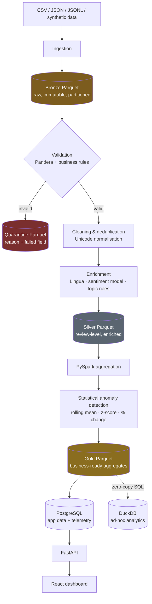

# Pensieve

**Consumer Intelligence & Data Analytics Platform**

Pensieve turns messy, multilingual customer feedback into clean, validated,
analytics-ready datasets — and presents sentiment, business trends, statistical
anomalies, data quality and pipeline health through an interactive dashboard.

It runs entirely locally and costs nothing. **There is no LLM anywhere in this
project**: language identification, sentiment and topic classification all run
on local, open models and transparent rules.

---

## Build progress

| Phase | Scope | Status |
|---|---|---|
| 0 | Plan, schemas, model selection, risk analysis | ✅ Complete |
| 1 | Foundation: repo, tooling, Docker, Postgres, API health, web shell | ✅ Complete |
| 2 | Synthetic data generator + ingestion → Bronze | ✅ Complete |
| 3 | Validation, quarantine, cleaning, dedup, quality score | ✅ Complete |
| 4 | NLP enrichment (language, sentiment, topics) → Silver | ⬜ Not started |
| 5 | PySpark aggregation → Gold + anomaly detection | ⬜ Not started |
| 6 | PostgreSQL schema, migrations, loader, REST API | ⬜ Not started |
| 7 | React dashboard (6 pages) | ⬜ Not started |
| 8 | Tests, CI, benchmarks, documentation | ⬜ Not started |

**What works today (verified by running it, not by assumption):**

- `docker compose up --build` brings up PostgreSQL, the API and the dashboard;
  all three report healthy, and nginx proxies `/api` so the browser sees one
  origin. Image sizes: **api 594 MB, web 49.8 MB**.
- `GET /api/v1/health` returns 200 in ~10 ms with a live PostgreSQL connection
  check, and reports `degraded` rather than hanging when the database is down.
- The dashboard renders that health data live through TanStack Query with
  Zod-validated responses — including loading, error and retry states.
- Six routes, responsive layout (sidebar collapses to a drawer below `lg`),
  light/dark theme persisted to `localStorage`, and a keyboard skip-link.
- **The ingestion pipeline runs end to end.** `make seed` generates a seeded
  multilingual dataset with deliberately broken records, ingests it into
  partitioned Bronze Parquet at **52,541 rows/sec**, and re-running it is a
  verified no-op because batches are identified by content checksum.
- **Validation, quarantine and quality scoring work on real data.** A measured
  5,150-row batch produced 4,729 valid records and 421 quarantined ones across
  5 distinct rules, with a quality score of **95.89/100** that shows its own
  arithmetic. Rejected records keep their original values and a reason.
- **256 tests pass** (11 API + 228 pipeline + 17 frontend). `ruff`,
  `mypy --strict` (46 files), `eslint --max-warnings 0` and `tsc` are clean.

The five dashboard pages beyond the overview deliberately render an explicit
"not built yet" panel. They show no numbers at all, because inventing metrics
to make a screenshot look finished would misrepresent what the platform has
measured.

> Nothing in this README is claimed to work until it has actually been run.
> Benchmark numbers appear only after the benchmark has executed on real hardware.

---

## The business problem

A consumer brand receives thousands of reviews a week across marketplaces, its
own site, app stores and email. The data is multilingual, inconsistently
formatted and partly broken. Product and CX teams need to answer questions that
raw review exports cannot:

- Which complaints are growing fastest, and in which market?
- Which brand or product has the worst sentiment right now?
- Are delivery complaints spiking, or is that just seasonal noise?
- Can we trust this week's numbers, or did we ingest bad data?

Pensieve answers those questions and — just as importantly — shows its work:
what was rejected, why, and how confident each signal is.

---

## Architecture



Full detail: [docs/implementation-plan.md](docs/implementation-plan.md)

---

## Technology

| Layer | Stack |
|---|---|
| Frontend | React, TypeScript, Vite, React Router, TanStack Query, TanStack Table, Recharts, Tailwind CSS, Zod, Vitest |
| Backend | Python 3.12, FastAPI, Pydantic v2, SQLAlchemy 2, Alembic, PostgreSQL 16 |
| Data | PySpark 4, PyArrow, Parquet, DuckDB, Pandera, pandas (small files only) |
| NLP | Lingua (language ID), multilingual transformer (sentiment), rule-based topics |
| Platform | Docker, Docker Compose, Makefile, GitHub Actions, structured JSON logging |

---

## Getting started

### Prerequisites

- Python 3.12
- Node.js 20+
- Docker Desktop (for PostgreSQL; also runs the Spark stage)
- **Java 17+ only if you want to run PySpark natively.** Otherwise the Spark
  stage runs in Docker. Check with `python scripts/check_env.py`.

### Local setup

```bash
python scripts/check_env.py
```

```bash
make setup
```

On Windows, `make` is often not installed. Use the bundled PowerShell runner,
which has identical targets:

```powershell
.\make.ps1 setup
```

### Run it

```bash
make dev
```

- API → http://localhost:8000 (docs at `/docs`)
- Dashboard → http://localhost:5173

### Docker

```bash
docker compose up --build
```

- Dashboard → http://localhost:5174
- API → http://localhost:8000 (docs at `/docs`)
- PostgreSQL → `localhost:5433` (5433, not 5432, to avoid clashing with a
  native Postgres install)

The PySpark stage is behind an opt-in profile because its image carries a JDK:

```bash
docker compose --profile spark run --rm spark-job
```

---

## Commands

| Command | What it does |
|---|---|
| `make setup` | Create the venv, install Python + npm dependencies, write `.env` |
| `make dev` | Run the API and the dashboard together |
| `make test` | Run pytest and vitest |
| `make lint` | ruff, mypy, eslint, tsc, prettier |
| `make seed` | Generate a synthetic dataset |
| `make pipeline` | Run Bronze → Silver → Gold end to end |
| `make benchmark` | Timed pipeline run; writes measured results |
| `make clean` | Remove generated data and caches |

---

## A note on where this repository lives

If you cloned this into OneDrive, Dropbox or another synced folder, exclude
`data/`, `.venv/` and `node_modules/` from sync — or move the repo to a plain
local path such as `C:\dev\pensieve`. Generated Parquet, a ~1 GB model cache and
`node_modules` inside a synced folder cause sync churn and intermittent
file-lock write failures that are easily mistaken for pipeline bugs.
`scripts/check_env.py` warns when it detects this.

---

## Documentation

| Document | Contents | Status |
|---|---|---|
| [implementation-plan.md](docs/implementation-plan.md) | Phases, schemas, risks, model selection | ✅ Written |
| `docs/architecture.md` | System design and component boundaries | Phase 8 |
| `docs/data-dictionary.md` | Every field in every layer | Phase 8 |
| `docs/pipeline-design.md` | Stage-by-stage pipeline behaviour | Phase 8 |
| `docs/business-requirements.md` | Problem, stakeholders, KPIs, acceptance criteria | Phase 8 |
| `docs/interview-guide.md` | The reasoning behind each decision | Phase 8 |

Unwritten documents are listed without links rather than created as empty
files — a stub that says "TODO" is worse than an honest gap.

---

## Licence

MIT
