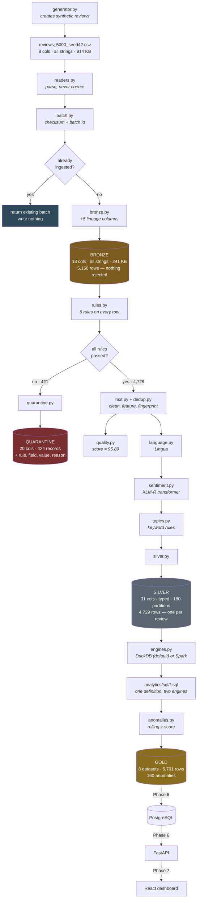

# Data Architecture — What Every Script Does to the Data

A living map of the pipeline. For each stage: **which script runs, what it
receives, what it does, and what it produces.** Updated as each phase lands.

Every number here was measured on a real 5,150-row run, not estimated.

---

## The whole journey at a glance



**Column count is the quickest way to read the pipeline:** 8 → 13 → 31.
Every stage adds knowledge and never removes the evidence.

---

## Stage 1 — Generation

**`pipelines/ingestion/generator.py`** + **`templates.py`**

| | |
|---|---|
| **Receives** | Nothing. A row count and a seed. |
| **Produces** | `data/samples/reviews_5000_seed42.csv` — 5,150 rows, 8 columns, 914 KB |

Combines a language-specific template with an optional opener and closer, then
attaches brand, product, country, rating and timestamp:

```
opener            "Dans l'ensemble, "
+ template        "emballage solide, {product} est arrivé en parfait état."
+ closer          " Je commanderai à nouveau."
```

Then damages ~12% of rows on purpose — duplicates, missing text, invalid
ratings, broken dates, HTML, odd Unicode, unsupported languages.

**Output columns (8, all strings):**
`review_id · brand · product · text · country · rating · source · created_at`

> Same seed, same day → byte-identical output. That is what makes ingestion
> idempotent and benchmarks comparable.

---

## Stage 2 — Ingestion

### `readers.py` — parse without judging

| | |
|---|---|
| **Receives** | A `.csv`, `.json`, `.jsonl` or `.parquet` file |
| **Produces** | A DataFrame where **every column is a string** |
| **Changes** | Nothing. `"seven"` stays `"seven"`. |

The one subtlety: `keep_default_na=False`. Without it pandas turns the literal
strings `"NA"`, `"null"` and `"None"` into missing values, so a review whose
text is genuinely the word "None" becomes indistinguishable from missing data.

### `batch.py` — identity and idempotency

| | |
|---|---|
| **Receives** | The file path |
| **Produces** | A `BatchMetadata`: ULID, SHA-256 checksum, row count, timestamps |
| **Decides** | Has this exact content been ingested before? |

Identity comes from **content, not filename**. The same file renamed is still
recognised as a duplicate. Without this, a job retried after a downstream
failure would double every row.

### `bronze.py` — land it, don't touch it

| | |
|---|---|
| **Receives** | The all-string frame + batch metadata |
| **Adds** | 5 lineage columns |
| **Produces** | Partitioned Parquet + manifest + a copy of the original file |

```
+ ingestion_batch_id      01KZBKPECRF42C509VFACH9QPZ
+ ingestion_timestamp     2026-08-06T13:20:10+00:00
+ source_file             reviews_5000_seed42.csv
+ source_format           csv
+ source_row_number       1     <- lets us say "row 180 of your file"
```

```
data/bronze/ingestion_date=2026-08-06/batch_id=01KZBK.../
    part-0000.parquet          13 cols · 241 KB  (74% smaller than the CSV)
    _batch_manifest.json       self-describing provenance
    source/reviews_5000.csv    the original, byte for byte
```

**Broken values that survive here untouched — by design:**

```
rating = '4.5'   '6'   '-2'
created_at = ''   '2026-13-45'   '0000-00-00'
```

Measured: **5,150 rows in 0.33s — 15,514 rows/sec.**

---

## Stage 3 — Validation

### `rules.py` — six rules, all applied to every row

| | |
|---|---|
| **Receives** | Bronze records (13 string columns) |
| **Produces** | A list of `ValidationFailure` — one per (row, rule) |
| **Changes** | Nothing. It only judges. |

| Rule | Severity |
|---|---|
| `review_id_missing` · `brand_missing` · `text_invalid` | error |
| `rating_out_of_range` · `created_at_invalid` · `review_id_duplicate` | error |
| `country_malformed` | **warning** — annotates, does not reject |

Every rule runs on every row: a record breaking three rules reports all three,
because whoever fixes the upstream feed needs the whole list.

### `quarantine.py` — rejected, never deleted

| | |
|---|---|
| **Receives** | The frame + the failures |
| **Produces** | `data/quarantine/batch_id=.../part-0000.parquet` — 20 columns |

Original values **plus** the explanation:

```
+ rule_id          rating_out_of_range
+ failed_field     rating
+ failed_value     '6'
+ failure_reason   rating must be a whole number between 1 and 5
+ severity         error
+ quarantined_at   2026-08-06T13:20:11Z
```

Measured: **421 rows quarantined, 424 records** — three rows broke two rules
each.

```
review_id_duplicate  150      created_at_invalid   60
text_invalid         111      brand_missing        40
rating_out_of_range   63
```

### `text.py` — clean structure, keep expression

| | |
|---|---|
| **Receives** | Raw text |
| **Adds** | `normalized_text` + 7 feature columns |
| **Never** | Modifies the original `text` column |

```
RAW  '<div class="review"><strong>Vitamin D Drops niedostępny...</strong></div>'
NORM 'Vitamin D Drops niedostępny od miesięcy, brak informacji o dostawie.'

RAW  '     Sabor horrible, amargo y con un regusto extraño.     '
NORM 'Sabor horrible, amargo y con un regusto extraño.'
```

| Removed | Kept |
|---|---|
| HTML, entities, script blocks | **Capitals** — `TERRIBLE` ≠ `terrible` |
| Zero-width chars, BOM, soft hyphens | **Emoji** — real sentiment signal |
| Excess whitespace | **`!!!` → `!!`** — shortened, not erased |
| URLs, emails, @mentions → placeholders | **The original**, in its own column |

Features added: `word_count · character_count · emoji_count ·
exclamation_count · uppercase_ratio · has_url · has_mention`

### `dedup.py` — mark, don't delete

Hashes normalised **brand + text**, so `"  GREAT  service!!! "` and
`"<p>GREAT service!!</p>"` collide correctly. Repeats get `is_duplicate_of`
pointing at the original.

> *"How many people complained"* and *"how many complaints were filed"* are
> different questions. Deleting duplicates answers only one.

### `quality.py` — one explainable number

```
Quality score: 95.9 / 100  (formula v1.0.0)
  100.0  base
  -  3.3  invalid records: 421 of 5,150 (8.2% x weight 40)
  -  0.6  duplicate records: 150 of 5,150 (2.9% x weight 20)
  -  0.1  missing required values: 129 of 5,150 (0.5% x weight 25)
  -  0.1  unparseable dates: 47 of 5,150 (0.9% x weight 15)
  =  95.9
```

**Also here: types are assigned.** Bronze keeps strings; from this point
`rating` is `Int8` and `created_at` is a real timestamp, because anything that
could not be converted is already in quarantine.

Measured: **5,150 → 4,729 valid in 0.83s.**

---

## Stage 4 — Enrichment

All three steps read **`normalized_text`**, never the raw text — HTML tags and
stray whitespace are noise to a language detector and a keyword matcher alike.

### `language.py` — Lingua

| | |
|---|---|
| **Adds** | `language · language_confidence · language_detected_name` |

Three distinct outcomes, deliberately not collapsed into two:

```
en/pl/hi/fr/de/es   detected, confident, supported
unsupported         confidently Italian/Portuguese/Dutch — worth knowing
unknown             below the confidence floor, or too short to call
```

Measured on 4,729 rows:

```
en 1861 · de 646 · hi 636 · fr 581 · es 458 · pl 440
unknown 75 · unsupported 32
```

> Text is truncated to 300 chars before detection. Language is identifiable
> long before a review ends: **10.60s → 6.75s with an identical distribution.**

### `sentiment.py` — local transformer, no API

| | |
|---|---|
| **Adds** | `sentiment · sentiment_score · sentiment_model_version` |

Two backends behind one protocol:

| Backend | Version stamp | Use |
|---|---|---|
| `TransformersBackend` | `cardiffnlp/twitter-xlm-roberta-base-sentiment@transformers` | Default |
| `LexiconBackend` | `lexicon-v1` | Tests and CI — no download |

**Every row records which one produced it**, so lexicon output can never be
mistaken for real inference in a dashboard or a benchmark.

Why the transformer is the default, in one example:

```
"Always in stock, I have never had trouble finding it."
   lexicon      negative     <- "never" is a negative word
   transformer  positive 0.647   <- reads the negation
```

Verified working across languages:

```
positive 0.944  Absolutely fantastic, best purchase all year!
negative 0.960  Terrible quality, it broke after two days.
negative 0.919  Die Lieferung war schrecklich spät...
positive 0.894  स्वाद बहुत बढ़िया है, बहुत पसंद आया।
positive 0.871  Świetna cena, produkt jest tańszy...
```

That last one matters: **Polish is not in the model's fine-tuning set.** It
works through XLM-RoBERTa's cross-lingual transfer, which is exactly why that
backbone was chosen — and it remains a documented limitation, not a guarantee.

### `topics.py` + `topic_rules.py` — explainable rules

| | |
|---|---|
| **Adds** | `primary_topic · topics · topic_match_reason` |

Keywords carry a weight — strong terms score 2, weak score 1 — so a review
mentioning two topics resolves sensibly instead of by dictionary order:

```
"The delivery was late and customer service never replied"
   primary : customer_support
   topics  : customer_support, delivery
   reason  : matched: customer service, replied
```

`other` when nothing matches — an honest outcome. A rising `other` share is the
signal that the taxonomy is drifting from what customers actually discuss.

### `silver.py` — the analytical record

Partitioned by **`review_date`** (when the customer wrote it), not ingestion
date, because almost every query is "the last 30 days" — which then reads 30
directories instead of all of them.

```
data/silver/review_date=2026-05-01/part-0000.parquet
```

**31 columns**, 180 partitions, one row per review.

> Silver **replaces** partitions rather than appending. It is a derived layer:
> re-running after a bug fix should produce a corrected Silver, not two
> contradictory copies. Bronze remains the immutable record, so nothing is lost.

---

## Measured performance

Real run, 5,150 Bronze rows, 16-core CPU:

| Stage | Duration | Throughput |
|---|---|---|
| Ingestion | 0.33s | 15,514 rows/s |
| Validation | 0.83s | 5,709 rows/s |
| — language detection | 6.75s | 700 rows/s |
| — topic classification | 0.34s | 13,845 rows/s |
| — sentiment (lexicon) | 0.06s | 76,768 rows/s |
| — sentiment (transformer) | — | **30 rows/s** |

**Sentiment on CPU is the bottleneck by three orders of magnitude**, and no
amount of tuning changes that — it is 278M parameters doing real work. Two
optimisations found while measuring:

- **Enabling real batching: 12 → 30 rows/s.** A transformers pipeline given a
  list processes it *one at a time* unless `batch_size` is set. It looks
  batched and runs sequentially.
- **Topic alternation regexes: 1,552 → 13,845 rows/s.** One compiled
  alternation per topic instead of ~200 separate searches.

---

## Column growth

| Layer | Columns | What was added |
|---|---|---|
| Source CSV | 8 | — |
| **Bronze** | 13 | +5 lineage |
| Quarantine | 20 | +7 rejection detail |
| **Silver** | 31 | +11 enrichment, +7 features, +2 dedup, +2 processing |

---

## Stage 5 — Gold

### `engines.py` — two engines, one SQL definition

| | |
|---|---|
| **Receives** | The Silver layer, registered as a `silver` view |
| **Produces** | Eight Gold datasets in Parquet |

```bash
python -m pipelines.jobs.run_gold                  # DuckDB  ~50 MB, 1.29s   (default)
python -m pipelines.jobs.run_gold --engine spark   # Spark   ~1-2 GB, 30.47s, needs Java 17+
```

The aggregation logic lives in `analytics/sql/*.sql`, not in engine-specific
code, so the two paths cannot drift apart. **Every Gold row records an `engine`
column** — there is no silent fallback, because a DuckDB run you believed was
Spark would invalidate every benchmark number.

DuckDB is the default because both engines produce byte-identical output and
DuckDB does it 24× faster at this size. Spark stays supported and tested behind
`--engine spark` and the `spark` Docker profile — it is the path that would not
need rewriting if the data grew a thousandfold.

A preflight check runs first when Spark is requested:

```
Cannot start Spark on this machine:
  - Java 8 detected; PySpark 4 requires Java 17+
```

### The eight datasets

| Dataset | Grain | Rows |
|---|---|---|
| `daily_brand_metrics` | date × brand | 450 |
| `daily_topic_metrics` | date × brand × topic | 4,769 |
| `country_metrics` | date × country | 630 |
| `language_distribution` | date × language | 636 |
| `sentiment_trends` | date × brand + rolling baselines | 450 |
| `anomalies` | detection events | 160 |
| `data_quality_metrics` | batch × rule | 5 |
| `pipeline_run_metrics` | run | 1 |

**Every query filters `is_duplicate_of IS NULL`.** Counting a duplicate twice
would inflate volume and skew sentiment. A test asserts this on all five
queries.

### `anomalies.py` — statistical, not magical

Four gates, all of which must pass:

```
volume >= 10 reviews        two negatives out of three means nothing
|z-score| >= 2.0            unusual against a 7-day trailing baseline
|change| >= 25%             significant but irrelevant is still irrelevant
direction matches           negativity falling is good news
```

The baseline is `.rolling(7).mean().shift(1)` — that `.shift(1)` excludes the
day being tested, because including it drags the mean toward the value under
test and hides the spike.

Real output:

> *Nimbus Drinks: daily review volume rose from 4.86 to 16.00 (+229.4%), which
> is 4.5 standard deviations from the 7-day baseline. Based on 16 reviews on
> the day.*

That is the signal the generator planted, found without being told it exists.

### `telemetry.py` — append-only run history

`data_quality_metrics` and `pipeline_run_metrics` describe **the pipeline**,
not the reviews, so Silver cannot produce them. The runner appends as it goes,
and nothing is ever rewritten — *"was this batch worse than last week's?"* is
unanswerable if last week's row was overwritten.

---

## Not yet built

| Stage | Script | Phase |
|---|---|---|
| Gold → PostgreSQL loader | `apps/api/app/services/` | 6 |
| Repository layer | `apps/api/app/repositories/` | 6 |
| 13 remaining endpoints | `apps/api/app/api/routes/` | 6 |
| 5 remaining dashboard pages | `apps/web/src/features/` | 7 |

---

## Reading this alongside the code

| Script | What to look at |
|---|---|
| `pipelines/ingestion/generator.py` | `_clean_row`, the defect injectors |
| `pipelines/ingestion/readers.py` | `keep_default_na=False` |
| `pipelines/ingestion/batch.py` | `find_batch_by_checksum` |
| `pipelines/ingestion/bronze.py` | `add_ingestion_metadata` |
| `pipelines/validation/rules.py` | `RULES`, `apply_rules` |
| `pipelines/validation/quality.py` | the weights and `explain()` |
| `pipelines/transformation/text.py` | `normalize_text`, `_as_text` |
| `pipelines/enrichment/sentiment.py` | the backend protocol, `batch_size` |
| `pipelines/enrichment/topics.py` | `_compiled_patterns` |
| `pipelines/jobs/run_pipeline.py` | stage telemetry |
