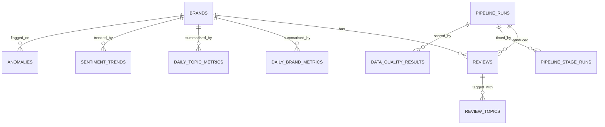

# Phase 6 — PostgreSQL, the Loader and the REST API

**Status: complete.** Numbers measured against a real 37,800-row Silver layer.

---

## What this phase is about

Phases 2–5 produced Parquet files. Parquet is excellent for what it is — a
columnar format for scanning many rows across few columns — and useless for
what a dashboard needs:

> Give me review #4821.
> Give me page 3 of reviews from France, sorted by rating, matching "delayed".
> Do that for twelve people at once, in under 200 ms.

Parquet has no indexes, no transactions, no concurrency story. **This phase
adds the serving layer.**

---

## The one idea that explains the rest

> **Parquet is the source of truth. PostgreSQL is a derived copy.**

Data flows one way — the loader writes to Postgres, the application never does.
Every decision follows from that:

| Decision | Because |
|---|---|
| The load is a full **replace**, not a merge | Reconciling a partial merge against an immutable source is work with no upside |
| It runs in **one transaction** | A failure halfway leaves yesterday's data serving traffic, not an empty dashboard |
| Ids are **deterministic** (`uuid5`) | Reloading keeps the same primary keys, so bookmarked links keep working |
| Truncating is safe | The data is derived; a rebuild takes ten seconds |

If Postgres and Parquet ever disagree, **Parquet wins**, and the fix is to run
the loader again.

---

## The schema

Thirteen tables. Nine come straight from the ERD; four are additions, each
noted below.



Plus three unlinked by a foreign key: `country_metrics`,
`language_distribution` and `review_date_bounds`.

### Where the tables come from

| Source | Tables |
|---|---|
| Silver | `brands`, `reviews`, `review_topics` |
| Gold aggregates | `daily_brand_metrics`, `daily_topic_metrics`, `country_metrics`, `language_distribution`, `sentiment_trends`, `anomalies` |
| Gold telemetry | `pipeline_runs`, `pipeline_stage_runs`, `data_quality_results` |
| Computed at load | `review_date_bounds` |

**Bronze and Quarantine never reach Postgres.** Nothing serves them to a user;
they exist for audit and replay, and that is a filesystem job.

### What I added beyond the ERD, and why

| Addition | Reason |
|---|---|
| `country_metrics`, `language_distribution`, `sentiment_trends` | Gold produces eight datasets; the ERD only had tables for two. The Brand and Trends pages need the other three, and recomputing them live would scan `reviews` on every page load |
| `reviews.sentiment_model_version` | Without it, a lexicon-scored row and a transformer-scored row are indistinguishable once they share a table |
| `reviews.is_duplicate_of` | The column every aggregate filters on |
| `pipeline_runs.duplicate_rows` | Rejected data and double-counted data are different problems |
| `pipeline_stage_runs.retry_count` | Succeeding on the third attempt is not the same as succeeding |
| `anomalies.z_score`, `explanation` | The detector produces them; dropping them would discard the evidence |
| `review_date_bounds` | One cached row so the Overview does not scan 37,800 to find two dates |

---

## Indexes that exist for a specific query

Not sprinkled on hopefully. Each one answers a query the dashboard actually
runs:

```sql
-- The Review Explorer's default: filter by brand, sort by date.
CREATE INDEX ix_reviews_brand_id_review_created_at ON reviews (brand_id, review_created_at);

-- Aggregate reads always want non-duplicates, so index only those.
CREATE INDEX ix_reviews_not_duplicate ON reviews (brand_id, review_created_at)
  WHERE is_duplicate_of IS NULL;

-- Free-text search. Without this, ILIKE '%late%' cannot use an index at all.
CREATE INDEX ix_reviews_text_trgm ON reviews USING gin (original_text gin_trgm_ops);
```

The trigram index needs the `pg_trgm` extension, created by hand in the
migration — **autogenerate cannot see extensions.**

### A trap worth knowing

The trigram index was originally written as a raw `op.execute` in the
migration. `alembic check` then reported:

```
Detected removed index 'ix_reviews_text_trgm' on 'reviews'
```

Alembic compares the database against the **model metadata**. An index the
models do not declare is one it will happily generate a migration to *drop*.
Declaring it on the model fixed it:

```python
Index(
    "ix_reviews_text_trgm",
    "original_text",
    postgresql_using="gin",
    postgresql_ops={"original_text": "gin_trgm_ops"},
)
```

`alembic check` now reports **"No new upgrade operations detected"** — the
schema and the models agree exactly.

---

## The loader

```bash
make load
```

```
Load complete in 9.72s

  brands                          5
  pipeline_runs                   1
  pipeline_stage_runs             3
  data_quality_results            5
  reviews                    37,800
  review_topics              45,390
  daily_brand_metrics           450
  daily_topic_metrics         4,769
  sentiment_trends              450
  country_metrics               630
  language_distribution         636
  anomalies                     160
  review_date_bounds              1

  total: 90,300
```

### 424 seconds → 9.7 seconds

The first working version used SQLAlchemy's `executemany`:

| Path | Duration | Rate |
|---|---|---|
| ORM `executemany` | **424s** | ~210 rows/sec |
| PostgreSQL `COPY` | **9.7s** | ~9,300 rows/sec |

**44× faster.** Every row in the ORM path costs a statement parse and a round
trip; COPY streams the whole batch over one statement. This is the standard
answer to bulk loading into Postgres, and the measurement is why it is worth
knowing rather than just believing.

COPY takes the raw psycopg connection **from the live SQLAlchemy connection**
rather than opening its own — otherwise it would commit independently and
break the single-transaction guarantee.

### Three type mismatches COPY exposed

The ORM had been quietly papering over all three:

| Symptom | Cause | Fix |
|---|---|---|
| `invalid input syntax for type integer: "14.0"` | pandas widens an int column containing nulls to float64 | Coerce columns the model declares as `Integer` |
| `cannot adapt type numpy.int64` | `to_dict()` yields numpy scalars | Convert via `.item()` |
| `SQLite DateTime type only accepts...` | Silver stores `processed_at` as an ISO string | Parse columns the model declares as `DateTime` |

All three are derived from the model's own column types, so a column added
later is handled automatically rather than failing on its first load.

---

## The bug this phase found in Phase 5

The load failed on:

```
duplicate key value violates unique constraint "pk_anomalies"
```

Investigating the Gold data:

```
total rows       : 160
distinct anom_id : 146
```

**Fourteen anomalies shared an id with another.** `anomaly_id` was built from
`metric:brand:date` — but the dataset also contains *topic-level* anomalies, and
topic was not in the id. A brand-level anomaly and a topic-level one on the
same brand, metric and day were indistinguishable.

Nothing had noticed, because nothing had used the id as a key until now. The
fix adds every dimension that varies:

```python
f"{metric}:{entity}:{date_part}:{topic or '-'}:{country or '-'}"
```

160 rows, 160 distinct ids. A regression test asserts it, and the unique
constraint on `anomaly_key` means the database would catch it again.

**This is the argument for constraints.** A `UNIQUE` the loader must satisfy
found a bug in code that had passed 34 tests.

---

## The API

Fourteen endpoints.

| Endpoint | Serves |
|---|---|
| `GET /health` | Liveness plus a real database check |
| `GET /overview` | The whole landing page in one request |
| `GET /brands`, `/brands/comparison` | Brand totals over a window |
| `GET /countries`, `/languages` | Dimension splits |
| `GET /trends/sentiment` | Per-brand series with trailing baselines |
| `GET /trends/topics` | Topic volume, plus the fastest-growing topic |
| `GET /anomalies` | Filtered by severity and metric, strongest first |
| `GET /reviews` | Paginated, 8 filters, free-text search, sorting |
| `GET /reviews/facets` | Filter options, read from the data |
| `GET /reviews/{id}` | One review with its processing provenance |
| `GET /pipeline-runs`, `/pipeline-runs/{id}` | Run history and stage timeline |
| `GET /data-quality`, `/data-quality/trend` | Quality report and score history |
| `POST /datasets/upload` | Store an uploaded file |
| `POST /pipelines/run` | Start a run in the background |

### Decisions worth defending

**The overview is one endpoint, not six.** Six parallel requests that must all
succeed before anything renders is six chances to show a spinner forever.

**Duplicates are hidden by default in `/reviews`.** Gold excludes them, so a
table that showed them would make the site contradict itself. `include_duplicates=true`
exists because inspecting them is sometimes the point.

**`sort` is an allow-list, not a passthrough.** Interpolating a user-supplied
column into `ORDER BY` is a SQL injection vector; sorting by an unindexed
column is a performance one.

**`/reviews/facets` is declared before `/reviews/{review_id}`.** Otherwise
"facets" parses as a review id and every request 422s.

**`POST /pipelines/run` returns 202, not 200.** A full run takes ~50 seconds.
Claiming completion in the response would be a lie the client cannot check.

**Percentages are recomputed from summed counts**, never averaged across days.
Averaging a percentage weights a day with 3 reviews the same as one with 300.

### Uploaded filenames are attacker-controlled

```
'../../../etc/passwd.csv'  ->  'passwd.csv'
'C:\Windows\System32\evil.csv'  ->  'evil.csv'
'a b;rm -rf.csv'  ->  'a_b_rm_-rf.csv'
```

Only the final path component survives, and everything outside
`[A-Za-z0-9._-]` is replaced. Five parametrised tests hold this.

---

## Measured

37,800 reviews in PostgreSQL, on this machine:

| | |
|---|---|
| `GET /overview` | **135 ms** |
| Load, full replace | **9.72s** for 90,300 rows |
| Second load | identical row counts — the replace really is idempotent |

Numbers reconcile end to end:

```
reviews in Postgres           37,800
non-duplicate                 21,933
sum(daily_brand_metrics)      21,933   <- Gold agrees exactly
brand totals via /brands      21,933   <- and so does the API
```

The API independently identified **`delivery`** as the fastest-growing topic —
the signal planted in the generator, found for a second time through an
entirely separate code path.

---

## Tests

**434 passed, 1 skipped** (Spark, no local JDK).

| Suite | Count |
|---|---|
| API endpoints | 74 |
| Loader | 27 |
| Pipelines | the rest |

API tests run against **in-memory SQLite**, so CI needs no service container.
What that cannot cover — the trigram index, the partial index and the COPY
path — is PostgreSQL-only and was verified by running it for real.

---

## Running it

```bash
docker compose up -d postgres
```

```bash
make migrate
```

```bash
make load
```

```bash
make load-counts
```

---

## What Phase 6 hands to Phase 7

Fourteen endpoints returning validated JSON with a single error envelope, and
OpenAPI at `/docs`. The dashboard's five unbuilt pages each map to one or two
of them:

| Page | Endpoints |
|---|---|
| Overview | `/overview` |
| Brands | `/brands/comparison`, `/countries` |
| Trends | `/trends/sentiment`, `/trends/topics`, `/anomalies` |
| Reviews | `/reviews`, `/reviews/facets`, `/reviews/{id}` |
| Data quality | `/data-quality`, `/data-quality/trend` |
| Pipeline runs | `/pipeline-runs`, `/pipeline-runs/{id}` |

Every one returns real, measured numbers. Phase 7 has nothing left to invent.

---

## Where this sits

```
Phase 2   raw file      -> Bronze          nothing lost
Phase 3   Bronze        -> clean records   nothing rejected without a reason
Phase 4   clean records -> Silver          language, sentiment, topics
Phase 5   Silver        -> Gold            aggregation and anomalies
Phase 6   Gold          -> PostgreSQL      the API serves it        <- you are here
Phase 7   API           -> dashboard       six pages of real numbers
```
